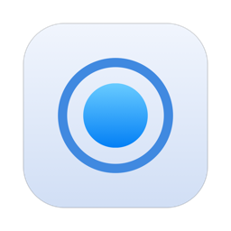
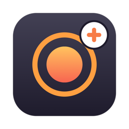

<p align="center">
  
  
</p>

# TinyMac

**TinyTask for the Mac, 1:1.**

TinyMac is a port of [TinyTask](https://web.archive.org/web/2020/https://www.tinytask.net/) 1.77, the tiny Windows
macro recorder. It is not an app *inspired by* TinyTask; it is TinyTask: the same six buttons, the same settings, the
same hotkeys, the same timings, the same `.rec` files.

If you just want TinyTask on your Mac, this is it. If you like TinyTask but always wished it did a few more things,
there is **TinyMac Plus**: the same engine, with the extras people have asked for for years.

## Pick your version

| | **TinyMac** | **TinyMac Plus** |
|---|---|---|
| For | People who want TinyTask, nothing more | People who want TinyTask, plus the obvious extras |
| Behaviour | Identical to TinyTask 1.77 | Identical to TinyTask 1.77 with every extra switched off |
| Recording engine | TinyTask's | The same, shared code |
| `.rec` files | Read and written byte for byte | Read and written byte for byte |
| Settings | TinyTask's `[TinyTask]` keys | The same keys, extras in their own section |
| Extras | None, on purpose | Editor, scroll wheel, custom hotkeys, panic stop, progress overlay, per-recording settings, screen scaling, menu bar icon, countdown |

Both apps share one settings file, open the same recordings and can be installed side by side.

## Why 1:1

Most macro recorders for the Mac are *TinyTask-style*: they borrow the idea and then do things their own way, with a
new file format, a library, a timeline, an onboarding flow. TinyMac does the opposite. It reproduces what TinyTask
actually does, down to the details:

- **Same files.** A `.rec` recorded on Windows plays on the Mac, and one recorded on the Mac plays in TinyTask.
- **Same speeds.** ½x, 1x, 2x, 100x and a custom multiplier, with TinyTask's own rules (100x skips mouse moves the
  way TinyTask does, a custom speed of 1 plays at ½x).
- **Same recording.** TinyTask samples the keyboard and mouse every 10 ms; so does TinyMac. Recordings come out with
  the same events and the same timing.
- **Same hotkeys.** Ctrl+Shift+Alt+R / P, Print Screen, F8 or F12. Pause and Scroll Lock stop playback.
- **Same settings.** The same keys, values and defaults as `tinytask.ini`.
- **Same Compile.** Turn a recording into a standalone app that plays it and quits, like TinyTask's `.exe`.
- **Same quirks.** Even the odd ones are kept, because muscle memory depends on them.
  [`COMPATIBILITY.md`](COMPATIBILITY.md) lists them all.

The only changes are the ones a Mac needs: Option instead of Alt, F13/F14/F15 for the keys Mac keyboards lack, `.app`
instead of `.exe`, and a native toolbar.

## TinyMac Plus

Everything above, plus:

- **Edit recordings.** Change delays and positions, delete events, insert waits, trim the start or the end, speed up
  or slow down a part. No more re-recording a whole macro to fix one click.
- **Scroll wheel.** TinyTask never recorded the wheel. Plus records and replays it, trackpad scrolling included.
- **Custom hotkeys.** Any key combination for record and play, instead of the four fixed choices.
- **Panic stop.** Press Esc, or move the mouse, to stop a playback.
- **Progress overlay.** A small floating panel with the loop count, elapsed time and progress.
- **Per-recording settings.** Speed and loops are saved next to each `.rec`, and the loop count survives a restart.
- **Screen scaling.** Positions are scaled when you play a recording on a display of a different size.
- **Menu bar icon.** Record, play and stop from the menu bar.
- **Countdown.** An optional 3-second countdown before recording starts.

Every extra can be switched off in **Prefs › Plus Options**. Files stay TinyTask files: the extra settings live in a
small `<name>.rec.tinymac` file next to the recording, which TinyTask simply ignores.

## Install

Both apps are universal (Apple silicon and Intel) and need macOS 13 or later.

### With Homebrew (easiest)

```bash
brew tap raffaelegnini/tinymac
brew trust raffaelegnini/tinymac

brew install --cask tinymac        # TinyMac: TinyTask 1:1
brew install --cask tinymac-plus   # TinyMac Plus: TinyTask plus the extras
```

`brew trust` is needed once: recent Homebrew versions only load casks from taps outside Homebrew after you trust them.

Homebrew puts the app in `/Applications` and lets macOS open it without the Gatekeeper warning. Update with
`brew upgrade --cask tinymac` (or `tinymac-plus`).

### Manual download

1. Download the latest release from the [Releases](../../releases/latest) page:
   - `TinyMac-<version>-macOS.zip` for TinyMac
   - `TinyMacPlus-<version>-macOS.zip` for TinyMac Plus
2. Unzip it and move the app to `/Applications`.
3. The apps are signed ad hoc, not notarised, so macOS blocks them the first time you open them. Open the app once,
   then go to **System Settings › Privacy & Security** and click **Open Anyway**. Or run:

   ```bash
   xattr -dr com.apple.quarantine /Applications/TinyMac.app       # or TinyMacPlus.app
   ```

## Permissions

On first launch, TinyMac needs two permissions in **System Settings › Privacy & Security**:

- **Accessibility**, to replay input
- **Input Monitoring**, to record input

Grant both, then quit the app (⌘Q) and open it again. TinyMac and TinyMac Plus are separate apps, so each one needs
its own permissions.

## Usage

| Button | Action |
|---|---|
| **Open** | Load a `.rec` recording (`O` key). |
| **Save** | Save the current recording as `.rec`. |
| **Rec** | Start or stop recording. Default hotkey: Ctrl+Shift+Option+R. |
| **Play** | Play the recording. Default hotkey: Ctrl+Shift+Option+P. Press the hotkey again to stop. F15 (Pause) and F14 (Scroll Lock) also stop playback. |
| **.app** | Compile the recording into a standalone app. The app plays the recording with the current speed and loop count, then quits. |
| **Prefs** | Open the preferences menu (Return key). |

The preferences menu contains:

- Playback speed: ½x, 1x, 2x, 100x or a custom value
- Continuous playback and the number of playback loops
- Record and play hotkeys: Ctrl+Shift+Option+R/P, Print Screen (F13), F8 or F12
- Always on top
- Captions
- Custom toolbar: a strip image with 7 sprites
- Website and About
- In TinyMac Plus: **Edit Recording...** and **Plus Options**

Settings live in `~/Library/Application Support/TinyMac/TinyMac.ini`. The file uses the same `[TinyTask]` section and
keys as the Windows `tinytask.ini`.

## Build

The build needs macOS 13 or later and Xcode or the Command Line Tools (Swift 5.9+).

```bash
./build.sh     # dist/TinyMac.app and dist/TinyMacPlus.app, universal, signed ad hoc, plus release zips
swift test     # engine tests
```

The code is split so that the 1:1 promise holds by construction:

- `Sources/TinyMacCore`: the TinyTask engine, shared by both apps
- `Sources/TinyMac`: TinyMac, which is only the engine
- `Sources/TinyMacPlus`: the extras, which hook into the engine without changing it

## Compatibility

[`COMPATIBILITY.md`](COMPATIBILITY.md) describes:

- the `.rec` file format
- the settings keys
- the behaviour TinyMac shares with TinyTask
- the differences on macOS
- what TinyMac Plus adds

## License

MIT. See [`LICENSE`](LICENSE).

TinyMac is an independent project. It is not affiliated with or endorsed by the author of TinyTask, and it contains
none of TinyTask's code. TinyTask was discontinued by its author in 2020; the tinytask.net domain now belongs to a third
party, so the links here point to the archived original site.
